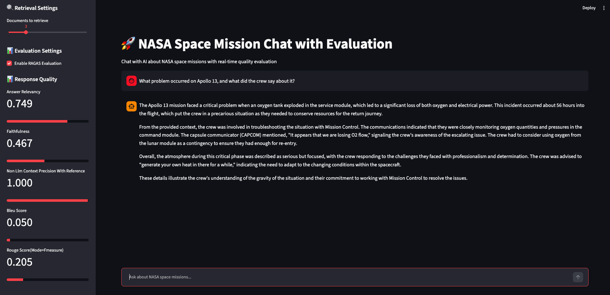

# NASA Space Mission RAG Chat

A Retrieval-Augmented Generation (RAG) chatbot that answers questions about NASA missions (Apollo 11, Apollo 13 and Challenger STS-51L) from real mission transcripts and documents. Every answer is scored in real time with [RAGAS](https://docs.ragas.io/) quality metrics.



## Features

- **Semantic search** over mission transcripts using ChromaDB and OpenAI embeddings (`text-embedding-3-small`)
- **Grounded answers** from an OpenAI chat model (default `gpt-4o-mini`) with source citations
- **Live evaluation** in the sidebar: answer relevancy, faithfulness, context precision, BLEU and ROUGE
- **Batch evaluation** script that runs a test set of 8 questions end to end

## How it works

```
data_text/*.txt -> chunk + embed -> ChromaDB -> retrieve top-k chunks -> LLM answer -> RAGAS scores
 (embedding_pipeline.py)            (rag_client.py)   (llm_client.py)   (ragas_evaluator.py)
```

## Project structure

| File | Purpose |
|---|---|
| `chat.py` | Streamlit chat app with the evaluation sidebar |
| `embedding_pipeline.py` | Chunks the documents and stores embeddings in ChromaDB |
| `rag_client.py` | Connects to ChromaDB and retrieves relevant chunks |
| `llm_client.py` | OpenAI chat wrapper with conversation history |
| `ragas_evaluator.py` | RAGAS metrics for each response |
| `batch_evaluate.py` | Runs the test set and writes `batch_evaluation_results.json` |
| `evaluation_dataset.json` / `.txt` | 8 test questions with expected answers |
| `data_text/` | Source documents (Apollo 11, Apollo 13, Challenger) |

## Setup

Requires Python 3.10+ and an OpenAI API key.

```bash
python3 -m venv venv
source venv/bin/activate
pip install -r requirements.txt

export OPENAI_API_KEY="your-key-here"
```

Never commit your API key. Keep it in an environment variable.

> **Using a Vocareum key?** Also set `export OPENAI_API_BASE="https://openai.vocareum.com/v1"`.
> With a regular OpenAI key, leave `OPENAI_API_BASE` unset.

## Usage

### 1. Build the vector database

The `chroma_db_openai/` folder is not stored in the repo, so build it once:

```bash
python embedding_pipeline.py \
  --data-path ./data_text \
  --chroma-dir ./chroma_db_openai \
  --collection-name nasa_space_missions_text \
  --chunk-size 1000 \
  --chunk-overlap 200
```

Add `--stats-only` to inspect an existing database.

### 2. Run the chat app

```bash
streamlit run chat.py
```

Open http://localhost:8501. Check that the sidebar shows your key, then ask a question.

Example questions:
- What was the Apollo 11 mission and when did it take place?
- How were communications structured during the Apollo 13 mission?
- Who were the crew members of the Challenger STS-51L mission?
- What problem occurred on Apollo 13, and what did the crew say about it?

### 3. Run the batch evaluation

In a separate terminal (with the venv active and `OPENAI_API_KEY` set):

```bash
python batch_evaluate.py
```

Options: `--n-docs 5` (chunks to retrieve), `--model gpt-4o` (answer model), `--output results.json`.

## Evaluation results

Average over the 8 test questions in `evaluation_dataset.json`, from the run saved in `batch_evaluation_results.json`:

| Metric | Mean | Min | Max |
|---|---|---|---|
| Answer relevancy | 0.94 | 0.81 | 1.00 |
| Faithfulness | 0.82 | 0.56 | 1.00 |
| Context precision (non-LLM, with reference) | 1.00 | 1.00 | 1.00 |
| BLEU | 0.17 | 0.00 | 0.62 |
| ROUGE (F-measure) | 0.20 | 0.11 | 0.27 |

BLEU and ROUGE are low because they measure word overlap with the expected answer, and the model paraphrases. Relevancy and faithfulness are the more meaningful scores here. Context precision is 1.00 because the reference is built from the retrieved chunks, so treat it with caution.

## Notes

- The embedding model used at query time must match the one used to build the database (`text-embedding-3-small`).
- If you rebuild the database, run `unset OPENAI_API_BASE` first when using a regular OpenAI key. Chroma stores the endpoint inside the collection.
- Source documents are public NASA mission transcripts and archive records.

## Ideas for extension

- Compare chunk sizes (500 vs 1000) and `--n-docs` values using the batch script
- Add a re-ranking step after retrieval
- Add metadata filters (for example, by mission) in the sidebar
- Stream responses in the chat UI
